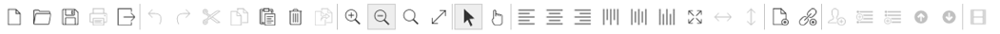

# Toolbar

The bar of icon button let you access the frequently used actions. The icons are contextually activated so only relevant icons can be accessed. Other icons are dimmed if unavailable.

A handy tooltip pops-up to remind you of the function of the button, if the icon is activated.\

It is possible to toggle the appearance of the toolbar from the workspace by choosing the menu View > Toolbar..
